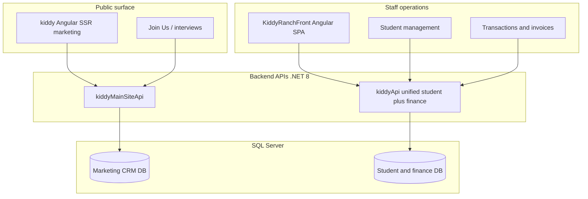
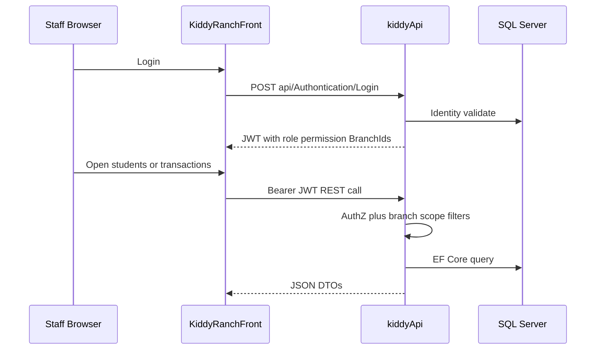

# Kiddy Ranch Platform

**Full-stack nursery & preschool platform** covering a public marketing site, admissions workflows, enrolled student operations, and day-to-day financial transactions.

> **Portfolio case study** — This public repository documents architecture and verified capabilities. It does **not** contain private application source code.

| | |
|---|---|
| **Role highlighted** | Full Stack Web Developer |
| **Primary stack** | Angular · ASP.NET Core · SQL Server |
| **Domain** | Nursery / preschool operations + public website |
| **Live marketing site** | [www.kiddyranch.com](https://www.kiddyranch.com) |
| **Author of this case study** | [Amira Gomaa](https://github.com/amiragomaa2597) |

---

## Table of Contents

1. [Project Overview](#1-project-overview)
2. [Project Purpose](#2-project-purpose)
3. [My Role and Contributions](#3-my-role-and-contributions)
4. [System Architecture](#4-system-architecture)
5. [Frontend Technologies](#5-frontend-technologies)
6. [Backend Technologies](#6-backend-technologies)
7. [Database Architecture](#7-database-architecture)
8. [Main Features](#8-main-features)
9. [API Architecture](#9-api-architecture)
10. [Authentication and Security](#10-authentication-and-security)
11. [Technical Challenges and Solutions](#11-technical-challenges-and-solutions)
12. [Screenshots](#12-screenshots)
13. [Demo / Live Platform](#13-demo--live-platform)
14. [Project Structure](#14-project-structure)
15. [Source Code Availability](#15-source-code-availability)

---

## 1. Project Overview

**Kiddy Ranch** is a multi-app educational operations system for a nursery/preschool brand. It combines:

1. A **public website** for families (story, programs, enrollment path, interviews)
2. An **admissions / CRM API** for student interviews, calls, and site content
3. An **operations SPA** for enrolled students, classes, buses, users, and finance
4. A **unified student + transactions API** for records, payments, accounts, and reporting

Private source repositories analyzed for this case study:

| Layer | Repository | Responsibility |
|-------|------------|----------------|
| Marketing frontend | `amiragomaa2597/kiddy` | Angular public site + interview admin UI (SSR-capable) |
| Marketing / CRM API | `amiragomaa2597/kiddyMainSiteApi` | Interviews, calls, branches, sections, images |
| Ops frontend | `amiragomaa2597/KiddyRanchFront` | Student CRM + invoices/transactions UI |
| Ops / finance API | `amiragomaa2597/kiddyApi` | Students, registration, transactions, accounts, payments |

---

## 2. Project Purpose

Support a real nursery business end-to-end:

- Attract and inform families through a public landing experience
- Capture admissions interest (student interviews, call logs)
- Manage enrolled children (profiles, classes, buses, registration workflow)
- Track **financial transactions** (income, expense, transfer), accounts, payment items, and reports
- Keep staff access controlled by roles, permissions, and branch scope

This is the same problem space educational employers care about: learner/student records, operational tooling, and payment workflows—not a toy landing page alone.

---

## 3. My Role and Contributions

### Professional profile (stated)

- Full Stack Web Developer
- Approximately **3 years** of professional software development experience
- Strong experience with **C#, ASP.NET Core, Angular, SQL Server**, and full-stack delivery

### How to read this section

Related GitHub history includes multiple contributors and collaborating repositories. This case study therefore describes **verified platform capabilities** and a **full-stack contribution profile**, without claiming sole ownership of every module.

| Contribution area | Evidence basis |
|-------------------|----------------|
| Public nursery landing + admissions UI | `kiddy` Angular app (landing, join-us, dashboard interviews) |
| Student management (ops) | `KiddyRanchFront` student pages/services + `kiddyApi` Student APIs |
| Transactions / finance | Invoice UI routes + `Transactions` / `Accounts` / `PaymentItem` APIs |
| Auth and access control | JWT + Identity on both APIs; role/permission guards on ops frontend |
| API / DB design | EF Core models and migrations across both backends |

**Needs confirmation:** exact personal ownership percentage per module, production DevOps ownership, and which screenshots represent personal vs team work.

---

## 4. System Architecture



**Verified product split**

- Marketing / admissions: `kiddy` ↔ `https://apikiddyranch.kiddyranch.com/api` (`kiddyMainSiteApi`)
- Operations / finance: `KiddyRanchFront` ↔ `https://studentapi.kiddyranch.com/` (`kiddyApi`)

In-repo ops docs describe a **historical merge** of a separate invoice API into the student API (`kiddyApi/scripts/DEPLOY-UNIFIED.md`).

---

## 5. Frontend Technologies

### Public site — `kiddy`

| Technology | Verified detail |
|------------|-----------------|
| Angular | ~17.3 |
| SSR | `@angular/ssr` / Express SSR scripts |
| UI | Bootstrap 5, PrimeNG 17 |
| Auth client | JWT in `localStorage`, Bearer interceptor, `AuthGuard` |

### Operations SPA — `KiddyRanchFront`

| Technology | Verified detail |
|------------|-----------------|
| Angular | ^20.1 |
| UI | Bootstrap 5, Chart.js / ng2-charts, Font Awesome |
| Finance export | jsPDF, html2pdf.js, html2canvas, xlsx |
| Auth | jwt-decode, role guards, permission checks, Bearer interceptor |
| Locale | Default `ar-EG`, custom language toggle (LibreTranslate-assisted) |

---

## 6. Backend Technologies

### Both APIs

| Technology | Verified detail |
|------------|-----------------|
| Runtime | .NET 8 (`net8.0`) |
| Style | N-tier (API / BL / DAL) |
| ORM | Entity Framework Core + SQL Server |
| Auth | ASP.NET Core Identity + JWT Bearer |

### `kiddyApi` (students + transactions)

- AutoMapper, MailKit email / OTP flows
- Branch-scoped query filters via current-user service
- Hosted background job for sales/target status updates
- Large migration history (dozens of EF migrations), including invoice-domain merge migration

### `kiddyMainSiteApi` (marketing / CRM)

- ClosedXML / EPPlus Excel exports for interviews
- Branch / section / image content for the public site
- SignalR registered (no hub mapped in analyzed snapshot)

---

## 7. Database Architecture

### Operations DB (`StoreContext` in `kiddyApi`) — verified entities include

- **People / ops:** `Student`, `Bus`, `Course`, `Class`, `StudentClass`, `StudentRegistrationRequest`, `Permission`, `UserPermission`
- **Finance:** `Account`, `Transaction`, `PaymentItem`, `IncomeCategory`, `ExpenseCategory`, `Policy`, plus legacy student finance tables (`Income`, `Outgoing`, `Treasury`, …)
- **Org:** `Branch`, `UserBranch`, `User` (Identity)

```mermaid
erDiagram
  USER ||--o{ USER_BRANCH : has
  BRANCH ||--o{ USER_BRANCH : includes
  STUDENT ||--o{ STUDENT_CLASS : enrolled
  CLASS ||--o{ STUDENT_CLASS : contains
  ACCOUNT ||--o{ TRANSACTION : records
  PAYMENT_ITEM ||--o{ TRANSACTION : categorizes
  STUDENT ||--o{ STUDENT_PAYMENT_ITEM : assigned
```

### Marketing DB (`AppDbContext` in `kiddyMainSiteApi`) — verified entities include

`User`, `Employee`, `StudentInterview`, `CareerInterview`, `Call`, `Section`, `ImageFile`, `Branch`, `Income` (marketing-site meaning—not the ops `Transaction` model)

---

## 8. Main Features

### Landing page (verified)

- Public home / brand landing (`Kiddy Ranch`, plus `Kiddy House` variant)
- Enrollment CTA / join-us interview intake
- Staff-managed sections and branch content via API
- Live public origin: **https://www.kiddyranch.com**

### Student management (verified)

| Scope | Where |
|-------|--------|
| Admissions interviews, status, birthdays, stats | `kiddy` UI + `StudentInterviews` API |
| Enrolled student CRUD, bulk import, active status | `KiddyRanchFront` + `api/Student` |
| Multi-step student/family data forms | Ops SPA pages (student, mother, father, more info, …) |
| Registration request workflow (public POST + admin review) | `api/StudentRegistrationRequests` |
| Classes, courses, buses | Ops SPA + matching controllers |

### Transactions & finance (verified)

- Income / expense / transfer transactions with pagination and bulk import
- Accounts, categories, payment items, policies
- Student payment history, remaining / next payments, year and financial reports
- Client-side PDF/Excel export tooling in the ops frontend

**Accuracy notes (verified absences)**

- No server-side PDF invoice generator found in either API
- WhatsApp appears as **stored contact fields / branch links**, not as a verified messaging API integration in these backends
- Marketing showcase copy that claims “WhatsApp integration” should be treated as **needs confirmation** unless a provider client is added later

---

## 9. API Architecture

### Operations API (`kiddyApi`) — sample surface

| Area | Examples |
|------|----------|
| Auth | `api/Authontication/Login`, register, change password, OTP reset |
| Students | `api/Student` upsert/list/filter/bulk-import |
| Registration | `api/StudentRegistrationRequests` (anonymous create + admin review) |
| Finance | `api/Transactions`, `api/Accounts`, `api/PaymentItem`, `api/Categories` |
| Ops | Courses, Classes, Buses, Permissions, Targets, Dashboard/statistics |

### Marketing API (`kiddyMainSiteApi`) — sample surface

| Area | Examples |
|------|----------|
| Auth | `User/login`, register |
| Admissions | `StudentInterviews`, `CareerInterviews`, Excel export |
| CRM | `Calls`, `Employees` |
| CMS | `Branches`, `Sections`, `Images` |

### Frontend ↔ backend sequence (ops)



---

## 10. Authentication and Security

**Only verified controls are listed.**

| Control | Where |
|---------|--------|
| ASP.NET Core Identity + JWT | Both APIs |
| Role policies (Manager/Admin variants) | `kiddyApi` |
| JWT claims for permissions and branch IDs | `kiddyApi` auth service + ops SPA decoding |
| Route guards (auth / role) | Both frontends |
| Bearer HTTP interceptors | Both frontends |
| Anonymous student registration endpoints | `kiddyApi` (intentional public intake) |
| Email OTP password reset | `kiddyApi` (MailKit) |
| CORS allowlists for kiddyranch hosts | Both APIs |

**Caveats (verified):** some marketing-API controllers rely lightly on `[Authorize]` in the analyzed snapshot; issuer/audience validation is disabled on the marketing API JWT setup. Treat hardening as an improvement area, not a hidden strength.

---

## 11. Technical Challenges and Solutions

| Challenge | Evidence-backed solution |
|-----------|--------------------------|
| Separate invoice and student products | Unified `kiddyApi` with invoice-domain migration + deploy docs |
| Multi-branch nursery data | Branch claims + EF global query filters in ops API |
| Public marketing vs private ops | Two Angular apps + two APIs with distinct hosts |
| Admissions before enrollment | Interview CRM on marketing stack; registration requests on ops API |
| Finance reporting for staff | Transactions module + charts + client PDF/Excel exports |
| Arabic-first staff UX | Ops SPA default `ar-EG` + language toggle |

---

## 12. Screenshots

Screenshots are **not published** here yet.

Nursery systems often display children’s names, parent phones, and payment amounts. Only anonymized images should be added under `assets/screenshots/` after a privacy review.

---

## 13. Demo / Live Platform

| Resource | URL | Notes |
|----------|-----|-------|
| Public website | https://www.kiddyranch.com | Marketing / family-facing site |
| Ops API host (committed FE env) | https://studentapi.kiddyranch.com/ | Authenticated staff API |
| Marketing API host (committed FE env) | https://apikiddyranch.kiddyranch.com/api | Public-site backend |

Private dashboards require credentials and must not be shared publicly. No demo passwords are published in this repository.

---

## 14. Project Structure

### This public portfolio repository

```text
Kiddy-Ranch-Platform/
├── README.md
├── docs/
│   ├── AGENT-PROMPT.md          # Reusable prompt to regenerate this case study
│   ├── ANALYSIS-SUMMARY.md
│   ├── CV-INTEGRATION.md
│   ├── architecture/OVERVIEW.md
│   └── features/CORE-FEATURES.md
└── assets/screenshots/README.md
```

### Private source (documented, not published)

```text
kiddy/                     # Angular marketing + interview admin (SSR)
kiddyMainSiteApi/          # .NET 8 marketing/CRM API
KiddyRanchFront/           # Angular ops SPA (students + finance)
kiddyApi/                  # .NET 8 unified student + transactions API
```

---

## 15. Source Code Availability

| Repository | Visibility | Contents |
|------------|------------|----------|
| **This repo** (`Kiddy-Ranch-Platform`) | **Public** | Case study documentation only |
| `amiragomaa2597/kiddy` | Private | Marketing frontend |
| `amiragomaa2597/kiddyMainSiteApi` | Private | Marketing / CRM API |
| `amiragomaa2597/KiddyRanchFront` | Private | Ops frontend |
| `amiragomaa2597/kiddyApi` | Private | Student + finance API |

Private source is withheld for IP protection and child/parent data safety.

---

## License

No open-source license is attached.  
All rights to the underlying Kiddy Ranch software remain with their respective owners.  
This material is for **professional portfolio / recruitment** use.

---

## Contact

GitHub: [@amiragomaa2597](https://github.com/amiragomaa2597)
